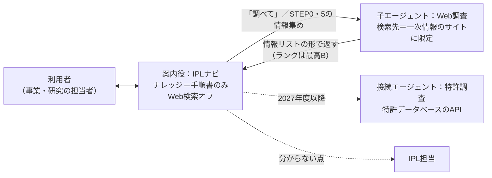

# エージェント構成（案内役と調査役を分ける）

> IPL標準フロー v1.2　対象：標準化チーム・エージェント作成担当

## 1. 構成

| エージェント | 種類 | 持つもの | 役目 |
| --- | --- | --- | --- |
| 案内役「IPLナビ」 | 親 | 手順書（ナレッジ）、[エージェント指示文.txt](エージェント指示文.txt) | 今のSTEPと次の一手の案内、シートの下書き、反証の候補出し。調べものが必要なときに調査役を呼ぶ |
| 調査役「Web調査」 | 子エージェント | 公開サイトのナレッジ（3章）、[調査エージェント指示文.txt](調査エージェント指示文.txt) | 公開情報を探し、情報リストの形で返す。判断はしない |
| チェック役「検証」 | 子エージェント（試行） | [検証エージェント指示文.txt](検証エージェント指示文.txt) | 判断メモ・情報リストなどの回答を8つの観点で点検する。書き換えない（[../docs/95_AIの品質を保つ仕組み.md](../docs/95_AIの品質を保つ仕組み.md)） |
| 特許調査（将来） | 接続エージェント | 特許データベースのAPI（4章） | 先行技術・競合特許の検索。IPL担当の確認とセットで使う |

子エージェントは親の中で一緒に管理するもの、接続エージェントは独立して公開・管理し、他のエージェントからも呼べるもの（Microsoft Learn：https://learn.microsoft.com/microsoft-copilot-studio/authoring-add-other-agents 、https://learn.microsoft.com/microsoft-copilot-studio/guidance/multi-agent-patterns ）。一部はプレビュー段階のため、作る前に現状を確認する。

## 2. 分ける理由

1. 案内役の回答に、手順書の外の情報が混ざるのを防ぐ。
2. 指示文の上限（1エージェント 8,000 文字）に収める。案内役の指示文はすでに約 7,700 文字。
3. 調査の品質ルール（一次情報優先、出典必須、ランクB止まり、社外秘を検索語に入れない）を1か所で管理できる。

## 3. 調査役の検索先（第1段階）

Copilot Studio の「公開サイト」をナレッジにすると、Bing で検索し、登録したサイトの結果だけを返す（生成モードで最大25サイト。https://learn.microsoft.com/microsoft-copilot-studio/knowledge-copilot-studio ）。全体の Web Search 設定（Bing が載せている全サイトを検索）は、第2段階で検討する。

登録するサイトの候補（社内で取捨選択する）：

| 分野 | サイト | メモ |
| --- | --- | --- |
| 特許 | patents.google.com | 公報の本文を検索結果から開ける。網羅的な調査には使えない |
| 特許 | worldwide.espacenet.com | 同上 |
| 特許・制度 | www.jpo.go.jp | 特許庁の統計・報告書・ガイドブック |
| 企業（日本） | disclosure2.edinet-fsa.go.jp | 有価証券報告書。検索結果に載りにくい可能性あり（未確認） |
| 企業（米国） | www.sec.gov | 10-K など |
| 研究 | jglobal.jst.go.jp、www.jstage.jst.go.jp | 研究者・論文 |
| 研究（医療・生命） | pubmed.ncbi.nlm.nih.gov | 論文 |
| 政策・規制 | www.meti.go.jp、laws.e-gov.go.jp | 政策資料・法令 |
| 統計 | www.e-stat.go.jp | 公的統計 |
| 研究開発の公的支援 | www.nedo.go.jp、www.jst.go.jp | プロジェクト・成果報告 |

- J-PlatPat は検索画面で結果を出すため、検索エンジン経由では公報を見つけにくいと推測される。登録しても効果は小さい可能性がある。
- 各社のIRページは案件ごとに変わるため、登録しない。必要なら第2段階の全体検索で扱う。
- 登録できるURLの形（階層の深さなど）に制限があるため、登録時に Microsoft Learn（https://learn.microsoft.com/microsoft-copilot-studio/knowledge-add-public-website ）で確認する。

## 4. 特許調査エージェント（第3段階）の候補

| 候補 | 中身 | 確認状況 |
| --- | --- | --- |
| 社内で契約している特許データベース | API があれば、カスタムコネクタで接続できる可能性 | 契約内容・API の有無は未確認 |
| 特許庁「特許情報取得API」 | 法人単位の利用登録制。特許が対象（案内：https://www.jpo.go.jp/system/laws/sesaku/data/api-provision.html 、手引き：https://www.jpo.go.jp/system/laws/sesaku/data/document/api-provision/api-provision-tebiki.pdf ） | キーワードでの先行技術検索に使えるかは未確認。番号を指定して書誌・経過を取る用途が中心と推測される |
| 欧州特許庁 Open Patent Services（Espacenet の API） | 登録して使う API | 本版では中身を確認していない |

## 5. 段階的な進め方

| 段階 | 時期 | 構成 | 進む条件 |
| --- | --- | --- | --- |
| 1 | 2026年度（〜3月） | 案内役＋子エージェント「Web調査」（一次情報サイトに限定） | テスト質問 T01〜T30 に合格 |
| 2 | パイロット後 | 調査役に Web Search（全体検索）を追加 | 外部への送信の扱いを情報システム部門・法務が確認済み |
| 3 | 2027年度以降 | 特許調査エージェントを接続エージェントとして追加 | API の利用登録・契約、IPL担当による検索結果の確認手順の整備 |

## 6. 注意（反証・見落としのリスク）

- **検索語が外に出る**：ウェブ検索は、利用者の質問を言い換えた検索語を Bing に送る（https://learn.microsoft.com/microsoft-copilot-studio/nlu-generative-answers-bing ）。出願前の発明・社外秘が検索語に入らないよう指示文で禁止しているが、指示だけで完全には防げない可能性がある。第1段階の前に、情報システム部門と法務に外部送信の扱いを確認する。組織の管理者がウェブ検索を止めている場合もある。
- **呼び出しの判断がずれる**：生成AIが自動で振り分けるため、呼ぶべきときに呼ばない・呼ばなくてよいときに呼ぶことがありうる。テスト質問 T21・T22 で確かめる。
- **費用**：エージェントを呼ぶたびにメッセージの消費が増える。パイロットで1案件あたりの消費量を測る。
- **ウェブ検索は先行技術調査の代わりにならない**：特許分類で検索できず、網羅性も分からない。調査役の結果は手がかりとして扱い、網羅的な調査は特許データベースで IPL 担当と行う。
- **検索の上限**：Bing に送る検索要求は 2,048 文字までという制限がある（同上）。長い会話の後では検索語が切れる可能性がある。
