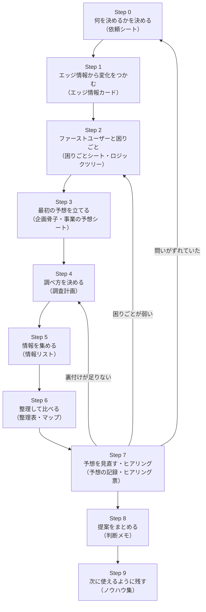

# IPL標準フロー v1.0 全体像

## 1. このフローの目的

IPランドスケープ（IPL）を「経営・事業の判断に使える形」で、担当者が変わっても同じ品質で進めるための標準手順。
特許庁の調査研究では、IPLを「経営戦略又は事業戦略の立案に際し、経営・事業情報に知財情報を組み込んだ分析を実施し、その結果を示すこと」と整理している（特許庁「経営戦略に資する知財情報分析・活用に関する調査研究」2020年度：https://www.jpo.go.jp/support/general/document/chizai-jobobunseki-report/chizai-jobobunseki-document.pdf ）。本フローもこの整理に沿い、**「何を決めるための調査か」から始めて、「判断メモ」で終わる**形にしている。

ここに、発明塾の考え方を組み込んだ。要点は次の4つ（詳しい対応は [90_発明塾手法との対応.md](90_発明塾手法との対応.md)）。

1. 網羅的な分析から入らず、意外性のある1件の「エッジ情報」から仮説を立て、飛び石のように次の情報へ進む。
2. 顧客は「市場セグメント」ではなく「まず一社・一人（ファーストユーザー）」まで具体化する。
3. 課題は「Aを良くするとBが悪くなる」というトレードオフまで掘り下げ、特許を「人・技術・権利」の3つの視点で読む。
4. 仮説は自分で提案書にして、自分でヒアリングに持ち込み、外れた情報も記録して「育てる」。

## 2. 10ステップの全体図

| Step | やること | できあがるもの | 個別手順書 |
| --- | --- | --- | --- |
| 0 | 誰が・いつまでに・何を決めるか、Go／やめる条件を決める | 依頼シート | [step0](steps/step0_何を決めるかを決める.md) |
| 1 | エッジ情報を1件から集め、「事実→解釈→将来の予想」につなげる | エッジ情報カード、変化と困りごとの表 | [step1](steps/step1_エッジ情報から変化をつかむ.md) |
| 2 | 最初に買う一社・一人を決め、困りごとをトレードオフまで掘る | 困りごとシート、課題‐解決ロジックツリー | [step2](steps/step2_ファーストユーザーと困りごと.md) |
| 3 | 企画骨子5項目と6つの観点で予想を書く | 企画骨子、事業の予想シート | [step3](steps/step3_最初の予想を立てる.md) |
| 4 | 予想ごとに必要な情報・場所・検索式・外れている証拠の探し方を決める | 調査計画 | [step4](steps/step4_調べ方を決める.md) |
| 5 | 特許・論文・市場・企業・規制の情報を集め、確かさのランクを付ける | 情報リスト | [step5](steps/step5_情報を集める.md) |
| 6 | ファミリー・名寄せをしてから分類し、表や図にする | 整理表・マップ | [step6](steps/step6_整理して比べる.md) |
| 7 | 予想を残す・直す・捨てる・保留に分け、仮説を持ち込んでヒアリングする | 予想の記録、ヒアリング票 | [step7](steps/step7_予想を見直す.md) |
| 8 | 研究する・出願する・組む・買う・見送るを比べ、Go／検証継続／Pivot／Stop を提案する | 判断メモ | [step8](steps/step8_提案をまとめる.md) |
| 9 | 判断の理由・検索式・AIの間違いを残し、振り返り日を決める | ノウハウ集 | [step9](steps/step9_次に使えるように残す.md) |

ステップ番号は、既存スキル（`ipl-navigator` / `ipl-hypothesis` / `ipl-evidence`）の Step 0〜9 と同じにしてある。Copilot Studio エージェントでも同じ番号で会話する。

### 各ステップの中の書き方（全ステップ共通）

1. 目的（1文）
2. 始める条件（前のステップから受け取るもの）
3. 手順（x-1, x-2 … の順。各手順に「やること」「目安時間」「AIに任せてよいこと／人がやること」）
4. 発明塾の使いどころ
5. できあがるもの
6. チェックポイント（確認する人・だめなら戻る先）
7. よくある失敗
8. 根拠（出典へのアクセス経路）

## 3. 共通ルール（全ステップで守る）

| ルール | 内容 |
| --- | --- |
| 事実・予想・未確認を分ける | 出典URLや文献番号を示せない事実は「未確認」と書く。 |
| 出典を付ける | 事実には出典URL・公報番号・DOI・EDINETの書類番号などを付ける。一次情報（特許公報、論文、公的文書、決算資料、会社の発表原文、経営者本人の発言）を優先する。 |
| 確かさのランク | A＝元の資料を人が開いて確かめた／B＝元の資料だがAIが読んだだけ、または独立した記事2つ以上／C＝まとめ記事1つだけ／D＝出典を確かめられない。提案の主な根拠はA・Bのみ。 |
| 表現 | 「調査で判明した」とは書かず「この範囲の調査では〜と推測される」と書く。大げさな言葉を使わない。 |
| 外れている証拠を探す | 有望と考えた理由と同じくらいの時間を、「買わない理由」「今の手段で十分な理由」「他社がまねできる理由」「利益が出ない条件」を探すのに使う。外れている証拠が見つからないことを、予想が正しい証拠にしない。 |
| まず書く | まとまってから書くのではなく、分かっている範囲で先に書き、「分かっていること／分かっていないこと」をはっきりさせる。 |
| 調べすぎない | ステップごとに時間の上限を決め、足りない部分は「未確認」として先に進む。深掘りは、判断を最も左右する不確かさから順に行う。 |
| AIの位置づけ | AIは下書き・抜け漏れ探し・外れている証拠の候補探しをする。判断・関係者との合意・元資料の確認は人がする。 |
| 秘密情報 | 未公開の自社発明・研究計画・事業計画をAIに入力する前に社内規程を確認する。 |

## 4. 役割

| 役割 | 主な仕事 | 主に関わるStep |
| --- | --- | --- |
| 意思決定者 | 何を決めるかの承認、Go／やめる条件の承認、最終判断 | 0, 8 |
| 依頼者（事業部・研究所など） | 背景・今ある予想の提供、ヒアリング先の紹介 | 0, 2, 7 |
| 担当リーダー | 進行管理、Step 1〜3・7のチェック | 1, 2, 3, 7 |
| 調査担当（知財・企画） | 情報の収集と整理、シートの作成 | 1〜7 |
| ベテラン調査者 | 検索式・母集団・分類のチェック | 4, 5, 6 |
| 事業・研究担当 | 顧客接触、技術の実現性、価格・販路の確認 | 2, 3, 7 |
| 意地悪なレビュー役 | 外れている証拠を探す（作業者とは別の人） | 7 |
| ナレッジ管理者 | ノウハウ集の保存、振り返りの日程管理 | 9 |
| AI（Copilot Studio エージェントなど） | 下書き、抜け漏れ探し、反証候補の提示、ひな形の案内 | 全Step |

知財担当だけで「売れる」と言い切らない。事業・研究・知財が同じ情報リストを見て判断する。

## 5. 進め方の大きさ

| 大きさ | 期間の目安 | やり方 |
| --- | --- | --- |
| Quick | 1〜2週間 | Step 0, 4, 5, 6, 8 を簡単に。Step 1〜3 は口頭確認と1枚メモ。くり返し1回。 |
| Standard | 1〜2か月 | 全ステップ。くり返し2回程度。ヒアリング1〜3件。 |
| Deep | 3か月以上 | 全ステップ。やめる条件を満たすまでくり返す。Step 7 は別の人がチェック。 |

どの大きさでも「何を決めるか」と「やめる条件」は省かない。

Standard の時間配分の例（4週間の場合。発明塾×IPL実践手順書 v1.0 第18章の運用例をもとに再構成）：

| 週 | 主なStep | 会議に持ち込むもの（各1件） |
| --- | --- | --- |
| 1 | 0, 1, 2, 3 | 新しいエッジ情報・更新した予想・外れている証拠・次の行動 |
| 2 | 4, 5, 6 | 同上 |
| 3 | 7（ヒアリング・見直し） | 同上 |
| 4 | 8, 9 | 判断メモ案 |

## 6. 目的モジュール（Step 1〜6 の力の入れどころが変わる）

| モジュール | こんなとき | 力を入れるStep |
| --- | --- | --- |
| A. 新しい市場・用途を探す | 自社技術の新しい使い道を探したい | 1, 2 |
| B. 研究テーマを探す | 次に何を研究するか決めたい | 1, 3, 7 |
| C. 今の事業を強くする | 競合と比べた強み・弱みを知りたい | 6, 7 |
| D. 出願の方針を決める | どこに特許を出すか決めたい | 4, 6 |
| E. 組む相手・買う相手を探す | 提携先やM&A候補を探したい | 6, 8 |
| F. 定期的に見張る | 競合や技術の動きを定期的に見たい | 4, 9 |
| G. 知財リスクを見る | 分野ごとの他社特許の壁を見たい（個別製品のFTOは別業務） | 4, 5 |
| H. 特許を活かす・社外に伝える | ライセンス先探し、統合報告書などでの説明 | 6, 8 |

特許庁「IPランドスケープ実践ガイドブック」（2024年）は、IPLの目的と15の分析手法を具体的な手順付きで示している。モジュールと分析手法の対応を決めるときに参照する（ページ番号は版によりずれる可能性があるため、本文で確認すること）。
- 案内ページ：https://www.jpo.go.jp/support/example/ip-landscape-guide/
- PDF：https://www.jpo.go.jp/support/example/ip-landscape-guide/document/index/all_guidebook.pdf

## 7. くり返しと、やめるタイミング

- Step 4〜7 はくり返す。戻る先：裏付けが足りない → Step 4／困りごとが弱い → Step 2／問いがずれていた → Step 0（意思決定者と相談し直す）。
- 顧客を変えたら、困りごとと解決策に戻る。競合が想定より強ければ、対象の市場を見直す。企画は一つの要素を変えると他も変わるので、全体を見直す。
- やめてよい条件（どれか1つ）：
  1. まだ分からないことの答えがどうであれ、判断が変わらない（いちばん大事）
  2. Step 0 で決めた条件で、Go かやめるかを判断できる
  3. 期限や予算に達した（確かめずに判断したことを判断メモに書く）

## 8. 案件ファイル（全ステップの進み具合を1か所で見る）

ひな形：[templates/00_案件ファイル.md](../templates/00_案件ファイル.md)
案件ごとに1つ作り、今どのステップにいるか、チェックポイントの記録、まだ分からないことを書く。Copilot Studio エージェントにも、まずこのファイルの内容を貼ってもらう運用にする。

## 9. このフローの限界（読む人へ）

- 本フローは社内の運用設計であり、発明塾（TechnoProducer 株式会社）の正式な手順・評価基準・認定ではない。
- 特許情報や公開統計は、販売数量や顧客の購買意向の直接の証拠にならない。最後は顧客の行動（有償評価・発注など）と実験結果で確かめる。
- 時間配分・ランク・チェックポイントの基準は、社内での試行（パイロット案件）で見直す前提のたたき台である。
