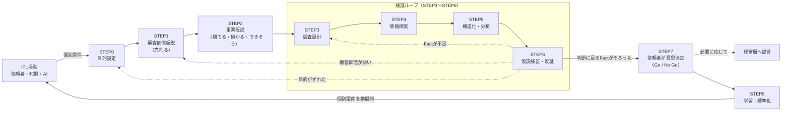

# IPL標準フロー 全体像

> IPL標準フロー v1.1　（はじめに：[00_はじめに.md](00_はじめに.md)）

## 1. 流れ

- STEP1・2 は、手元にある情報（社内の情報を含む）で立てます。本格的な調査は STEP3 から。
- 目的に応じて、STEP を飛ばしてかまいません（4章）。

## 2. 各STEPで、あなたがやること

| STEP | あなたがやること | できあがるもの | 手順書 |
| --- | --- | --- | --- |
| 0 目的設定 | 何を決めるための取り組みかを1文にし、Goとやめる条件を決める | 依頼シート | [STEP0](steps/STEP0_目的設定.md) |
| 1 顧客価値仮説（売れる） | 最初に買う一社・一人と、その困りごとを決め、「なぜ買うか」を書く | エッジ情報カード、困りごとシート、価値の仮説 | [STEP1](steps/STEP1_顧客価値仮説.md) |
| 2 事業仮説（勝てる・儲かる・できそう） | 競合に勝てる理由（特許で守れるかを含む）、儲かる理由、作れる理由を書く | 事業仮説シート | [STEP2](steps/STEP2_事業仮説.md) |
| 3 調査設計 | 仮説ごとに、何を・どこで・どう調べるか、外れている証拠をどう探すかを決める | 調査計画 | [STEP3](steps/STEP3_調査設計.md) |
| 4 情報探索 | 特許・論文・企業・市場の情報を集め、出典と確かさを記録する | 情報リスト | [STEP4](steps/STEP4_情報探索.md) |
| 5 構造化・分析 | 情報をまとめて分類し、表や図にして「だから何か」を書く | 整理表・マップ | [STEP5](steps/STEP5_構造化・分析.md) |
| 6 仮説検証・反証 | 仮説を残す・直す・捨てるに分ける。顧客に仮説を持ち込んで聞く | 仮説の記録、ヒアリング票 | [STEP6](steps/STEP6_仮説検証・反証.md) |
| 7 依頼者が意思決定 | 根拠と残る不確かさをそろえて、Go / No Go を決める | 判断メモ | [STEP7](steps/STEP7_意思決定.md) |
| 8 学習・標準化 | うまくいったこと・困ったことを振り返り、次の人が使えるように残す | 振り返りアンケート、ノウハウ集 | [STEP8](steps/STEP8_学習・標準化.md) |

## 3. もどるタイミング

| 気づいたこと | もどる先 |
| --- | --- |
| 判断に使える事実（Fact）が足りない | STEP3（調べ方を見直す） |
| 顧客の困りごと・価値が弱い | STEP1 |
| そもそも目的がずれていた | STEP0（依頼者・意思決定者と相談し直す） |

先に進めてよい目安（どれか1つ）：
1. まだ分からないことの答えがどうであれ、判断が変わらない（いちばん大事）
2. STEP0 で決めた条件で、Go か No Go かを判断できる
3. 期限や予算に達した（確かめずに判断したことを判断メモに書く）

## 4. 目的に応じて飛ばしてよいSTEP

| 目的 | 例 | 力を入れるSTEP | 軽くしてよいSTEP |
| --- | --- | --- | --- |
| 新しい用途・市場を探す | 自社技術の新しい使い道 | 1, 2, 6 | — |
| 研究テーマを決める | 次に何を研究するか | 1, 2, 6 | — |
| 今の事業を強くする | 競合と比べた強み・弱み | 3, 4, 5 | 1（今の顧客で確認するだけ） |
| 出願の方針を決める | どこに特許を出すか | 3, 5 | 1 |
| 組む相手・買う相手を探す | 提携先・M&A候補 | 4, 5, 7 | — |
| 定期的に見張る | 競合や技術の動き | 3, 8 | 1, 2（初回以降） |
| 知財リスクを見る | 分野ごとの他社特許の壁（個別製品のFTOは別業務） | 3, 4 | 1 |

どの目的でも、STEP0（目的設定）と STEP7（意思決定）は飛ばしません。

## 5. 役割

| 役割 | 主な仕事 | 主なSTEP |
| --- | --- | --- |
| あなた（事業・研究の担当者） | 仮説を立て、調べ、顧客に聞き、判断メモを書く | 0〜8 |
| 依頼者・意思決定者 | 目的とGo／やめる条件の承認、最終判断 | 0, 7 |
| IPL担当 | 伴走、2つの確認ポイント（STEP2後・STEP6後）、検索式のチェック | 2, 3, 6 |
| AIエージェント | 下書き、抜け漏れ探し、反証の候補出し、ひな形の案内 | 全STEP |
| 標準化チーム | 振り返りの集計、手順書とエージェントの改訂 | 8 |

AIは下書きと抜け漏れ探しをします。判断・関係者との合意・元の資料の確認は人がします。

## 6. 全STEP共通のルール

| ルール | 内容 |
| --- | --- |
| 事実・予想・未確認を分ける | 出典（URL・特許番号・DOIなど）を示せない事実は「未確認」 |
| 一次情報を優先 | 特許公報、論文、公的文書、決算資料、会社の発表原文 |
| 確かさのランク | A＝元の資料を人が開いて確かめた／B＝元の資料をAIが読んだだけ、または独立した記事2つ以上／C＝まとめ記事1つ／D＝出典を確かめられない。判断の主な根拠はA・Bだけ |
| 書き方 | 「調査で判明した」ではなく「この範囲の調査では〜と推測される」 |
| 反証を探す | 有望な理由と同じくらいの時間を、「買わない理由」「今の手段で十分な理由」「まねされる理由」「利益が出ない条件」を探すのに使う |
| まず書く | まとまってから書くのではなく、分かる範囲で先に書く |
| 調べすぎない | STEPごとに時間の上限を決め、足りない部分は「未確認」として先に進む |

## 7. 発明塾の手法との関係

このフローのSTEP名は、社内で共有しているフローの名前のままです。発明塾の手法は、各STEPの「やり方」の中で使います（例：STEP1 の「ファーストユーザーを決める」「課題‐解決ロジックツリー」）。対応は [90_発明塾手法との対応.md](90_発明塾手法との対応.md) を見てください。
