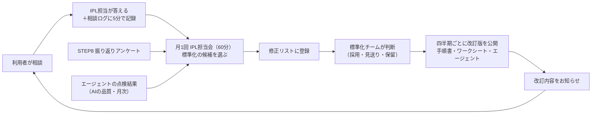

# 知見を回収して標準フローに戻す仕組み

> IPL標準フロー v1.1　対象：標準化チーム・IPL担当

## 1. 何が問題か

IPL担当が利用者から相談を受けるたびに、「手順書のここが分かりにくい」「この業界ではこう進めるとよい」といった知見がたまる。ただし、何もしなければ知見は**IPL担当それぞれの頭の中**に残り、標準フローには戻らない。STEP8（学習・標準化）は案件ごとの振り返りなので、案件をまたいでIPL担当に集まる知見は拾いにくい。

そこで、案件の振り返り（STEP8）とは別に、**IPL担当の相談を起点にした回収の流れ**を作る。

## 2. 全体の流れ

| 段階 | 何をする | 誰が | 頻度・時間 | 使うもの |
| --- | --- | --- | --- | --- |
| 1 記録 | 相談を受けたら、その日のうちに相談ログに1行書く | IPL担当 | 1件5分 | [IPL担当_相談ログ.xlsx](../deliverables/IPL標準フロー_IPL担当_相談ログ.xlsx) |
| 2 選ぶ | 相談ログ・振り返りアンケート・AIの点検結果を見て、標準フローに戻す候補を選ぶ | IPL担当会（IPL担当全員＋標準化チーム） | 月1回60分 | 相談ログの「標準化の候補」列 |
| 3 登録 | 候補を修正リストに書く（相談ログのNoを関連Noに書く） | 会の担当者 | 会の後1週間以内 | 修正リスト |
| 4 判断 | 採用・一部採用・見送り・保留を決め、理由を書く | 標準化チーム | 月1回（IPL担当会と同日でよい） | 修正リスト |
| 5 反映 | 採用分をまとめて手順書・ワークシート・エージェントに反映し、テストを流す | 標準化チーム | 四半期ごと（急ぎは随時） | リポジトリ、テストセット |
| 6 知らせる | 何が変わったかを1枚にまとめて知らせる | 標準化チーム | 改訂のたび | SharePoint のお知らせ、メール |

## 3. 相談ログに書くこと

1行1件。名前と日付に加えて、**手順書に書いてあったか**を必ず書く。これが、標準フローの足りないところを見つける一番の手がかりになる。

| 列 | 書くこと |
| --- | --- |
| 日付・IPL担当・相談者の部署 | 誰の相談を誰が受けたか（相談者の個人名は書かない） |
| 案件コード | 案件名は書かず、コードにする |
| STEP・手順番号 | どこで困ったか |
| 相談の種類 | 手順が分からない／ひな形の書き方／調べ方・検索式／判断の迷い／エージェントの使い方・誤り／その他 |
| 相談の内容・答えたこと | 2〜3行ずつ |
| 手順書に書いてあったか | 書いてあった／書いてあったが分かりにくい／書いていなかった |
| 標準化の候補 | はい／いいえ／会で相談 |
| 修正リストNo | 登録したら書く |
| タグ | 業界・技術分野など（あとで探すため） |

## 4. 続けるための工夫

- **記録を軽くする**：1件5分、選択肢を多くする。書くのが重いと続かない。
- **月1回の会で「選ぶ」だけにする**：会で修正案を書き上げるのではなく、候補を選んで担当を決めるところまで。
- **知らせて、変わったことを見せる**：自分の相談から手順書が変わったことが分かると、記録する動機になる。改訂のお知らせに「相談ログから〇件」と書く。
- **エージェントで要約する**：相談ログが増えたら、月1回の会の前にエージェント（または Copilot）に「書いていなかった」「分かりにくい」の行をSTEPごとにまとめさせる。まとめは下書きとして扱い、元の行を確かめる。

## 5. 見る数字

| 数字 | 意味 | 期待する動き |
| --- | --- | --- |
| 相談件数（STEP別） | どのSTEPで困っているか | 多いSTEPを重点的に見直す |
| 「書いていなかった」「分かりにくい」の割合 | 手順書の足りなさ | 改訂を重ねると下がる |
| 修正リストへの登録件数と反映件数 | 回収が回っているか | 登録が反映につながっている |
| 同じ相談のくり返し | 手順書に戻ったか | 反映後は減る |

## 6. STEP8・品質の仕組みとの関係

| 仕組み | 拾うもの | 単位 |
| --- | --- | --- |
| STEP8 振り返りアンケート | 案件を進めた本人の声 | 案件ごと |
| 相談ログ（この仕組み） | IPL担当に集まる、案件をまたいだ知見 | 相談ごと |
| AIの品質の見張り（[95_AIの品質を保つ仕組み.md](95_AIの品質を保つ仕組み.md) 層4） | エージェントの誤り | 毎月の抜き取り |

3つとも、出口は**修正リスト**に一本化する。入口が分かれていても、判断と反映は1か所で行う。

## 7. 反証・見落としのリスク

- IPL担当の人数が少ないと、記録と月1回の会が負担になり、続かない可能性がある。最初の3か月は記録の件数と所要時間を測り、重ければ項目を減らす。
- 相談ログには社外秘に近い内容が入りやすい。保存場所はIPL担当と標準化チームだけが見られる場所にし、エージェントのナレッジには入れない。
- 「書いていなかった」ことを全部手順書に足すと、手順書が厚くなりすぎる。業界や案件に固有の知見は、手順書ではなく「事例集」に分けて残す選択肢を持つ（v1.2 以降で検討）。
